<p align="center">
  
</p>

<p align="center"><b>English</b> · <a href="README.pt-BR.md">Português</a></p>

<p align="center">
  
  
  
  
  
  
</p>

<p align="center">
  
  
  
  
  
  
</p>

<p align="center"><sub>Built with Python, AWS SAM, GitHub Actions and Claude</sub></p>

<p align="center"></p>

> **Showcase repository, read-only.** This is a cut of the project: only the code, the tests and the infrastructure template. It holds no data or secrets and does not accept contributions. The code can be read but not copied or reused without written permission: see the [LICENSE](LICENSE).

# Robot

**Robot** (ロボット) turns your PC on and off by voice with Alexa: "Alexa, turn on the PC" and "Alexa, turn off the PC". The target cost is **R$ 0** and there is no hardware besides the PC and the Echo.

## Contents

- [I. What it does](#i-what-it-does)
- [II. How it works](#ii-how-it-works)
- [III. Status](#iii-status)
- [IV. Layout](#iv-layout)
- [V. Verify](#v-verify)
- [VI. Configuration and security](#vi-configuration-and-security)

## I. What it does

<table>
  <tr>
    <td width="72" align="center"></td>
    <td><b>Turn on</b><br>"Alexa, turn on the PC" makes the Echo broadcast a Wake-on-LAN packet and the PC wakes up.</td>
  </tr>
  <tr>
    <td align="center"></td>
    <td><b>Turn off</b><br>"Alexa, turn off the PC" becomes an action in a queue, and an agent on the PC shuts Windows down.</td>
  </tr>
  <tr>
    <td align="center"></td>
    <td><b>Outbound connections only</b><br>The PC never opens a port to the internet: the agent is the one that fetches the action from the queue.</td>
  </tr>
</table>

> **Language note.** The skill is validated in Brazilian Portuguese, so today the phrases Alexa recognizes are "Alexa, ligar o PC" and "Alexa, desligar o PC". The English phrases above are their translation.

## II. How it works

<table>
  <tr>
    <td width="72" align="center"></td>
    <td><b>Turn on</b><br>The Smart Home skill (development mode) answers with <code>DeferredResponse</code>, sends a <code>WakeUp</code> event to the Alexa gateway, and the Echo broadcasts the Wake-on-LAN packet.</td>
  </tr>
  <tr>
    <td align="center"></td>
    <td><b>Turn off, in the cloud</b><br>The Lambda writes a <code>shutdown</code> action to an SQS queue with 60 s retention.</td>
  </tr>
  <tr>
    <td align="center"></td>
    <td><b>Turn off, on the PC</b><br>A Python agent consumes the queue and shuts Windows down. It only runs actions from a fixed list, never an arbitrary command.</td>
  </tr>
</table>

```text
 on   Alexa ──► Smart Home skill ──► Alexa gateway ──► Echo ──► Wake-on-LAN ──► PC
 off  Alexa ──► Lambda ──► SQS queue ◄── agent on the PC (outbound only) ──► Windows shuts down
```

## III. Status

<table>
  <tr>
    <td width="72" align="center"></td>
    <td>Phases 1 to 4 accepted: "Alexa, turn on the PC" and "Alexa, turn off the PC" work. The agent starts at logon, so turning off does not work while the PC sits at the login screen. Phase 5 (hardening) is still missing.</td>
  </tr>
</table>

## IV. Layout

<table>
  <tr>
    <td width="72" align="center"></td>
    <td>
      <table>
        <tr><th align="left">Folder</th><th align="left">Contents</th></tr>
        <tr><td><code>lambda/</code></td><td>Lambda code (Python) and its tests</td></tr>
        <tr><td><code>agente/</code></td><td>The PC agent (Windows) and its tests; install steps in <code>agente/README.md</code></td></tr>
        <tr><td><code>infra/</code></td><td>AWS SAM template</td></tr>
        <tr><td><code>docs/</code></td><td>This README's images</td></tr>
        <tr><td><code>scripts/</code></td><td>Local and CI verification; the image generator</td></tr>
      </table>
    </td>
  </tr>
</table>

## V. Verify

<table>
  <tr>
    <td width="72" align="center"></td>
    <td>The tests use no network and no AWS, and never shut down any machine.</td>
  </tr>
</table>

```bash
python scripts/verificar.py --rapido     # before every commit
python scripts/verificar.py --completo   # before opening a PR
```

## VI. Configuration and security

<table>
  <tr>
    <td width="72" align="center"></td>
    <td>Secrets, account identifiers and the network card's MAC address never go into Git. They are passed as <code>sam deploy</code> parameters and live only in AWS. See <code>infra/README.md</code>. The agent's access key lives in the Windows Credential Manager. See <code>agente/README.md</code>.</td>
  </tr>
</table>

<p align="center"></p>

<p align="center"><sub>Images generated by <code>scripts/gerar_imagens.py</code> · fonts and licenses in <code>docs/imagens/FONTES.md</code></sub></p>
