<p align="center">
  
</p>

<p align="center"><a href="README.md">English</a> · <b>Português</b></p>

<p align="center">
  
  
  
  
  
  
</p>

<p align="center">
  
  
  
  
  
  
</p>

<p align="center"><sub>Feito com Python, AWS SAM, GitHub Actions e Claude</sub></p>

<p align="center"></p>

> **Repositório de vitrine, somente leitura.** Este é um recorte do projeto: só o código, os testes e o template de infraestrutura. Não tem dados nem segredos e não aceita contribuições. O código pode ser lido, mas não copiado nem reutilizado sem permissão por escrito: veja a [LICENSE](LICENSE).

# Robot

**Robot** (ロボット) liga e desliga o PC por voz com a Alexa: "Alexa, ligar o PC" e "Alexa, desligar o PC". O custo alvo é **R$ 0** e não há hardware além do PC e do Echo.

## Sumário

- [I. O que ele faz](#i-o-que-ele-faz)
- [II. Como funciona](#ii-como-funciona)
- [III. Estado](#iii-estado)
- [IV. Estrutura](#iv-estrutura)
- [V. Verificar](#v-verificar)
- [VI. Configuração e segurança](#vi-configuração-e-segurança)

## I. O que ele faz

<table>
  <tr>
    <td width="72" align="center"></td>
    <td><b>Ligar</b><br>"Alexa, ligar o PC" faz o Echo transmitir um Wake-on-LAN e o PC acorda.</td>
  </tr>
  <tr>
    <td align="center"></td>
    <td><b>Desligar</b><br>"Alexa, desligar o PC" vira uma ação numa fila, e um agente no PC desliga o Windows.</td>
  </tr>
  <tr>
    <td align="center"></td>
    <td><b>Só conexões de saída</b><br>O PC nunca abre porta para a internet: o agente é quem busca a ação na fila.</td>
  </tr>
</table>

## II. Como funciona

<table>
  <tr>
    <td width="72" align="center"></td>
    <td><b>Ligar</b><br>A skill Smart Home (modo desenvolvimento) responde com <code>DeferredResponse</code>, envia o evento <code>WakeUp</code> ao gateway da Alexa e o Echo transmite o Wake-on-LAN.</td>
  </tr>
  <tr>
    <td align="center"></td>
    <td><b>Desligar, na nuvem</b><br>A Lambda grava a ação <code>shutdown</code> numa fila SQS com retenção de 60 s.</td>
  </tr>
  <tr>
    <td align="center"></td>
    <td><b>Desligar, no PC</b><br>Um agente Python consome a fila e desliga o Windows. Só executa ações de uma lista fixa, nunca comando arbitrário.</td>
  </tr>
</table>

```text
 ligar     Alexa ──► skill Smart Home ──► gateway Alexa ──► Echo ──► Wake-on-LAN ──► PC
 desligar  Alexa ──► Lambda ──► fila SQS ◄── agente no PC (só saída) ──► Windows desliga
```

## III. Estado

<table>
  <tr>
    <td width="72" align="center"></td>
    <td>Fases 1 a 4 aceitas: "Alexa, ligar o PC" e "Alexa, desligar o PC" funcionam. O agente roda a partir do logon, então o desligar não funciona com o PC parado na tela de login. Falta a fase 5 (endurecer).</td>
  </tr>
</table>

## IV. Estrutura

<table>
  <tr>
    <td width="72" align="center"></td>
    <td>
      <table>
        <tr><th align="left">Pasta</th><th align="left">Conteúdo</th></tr>
        <tr><td><code>lambda/</code></td><td>Código da Lambda (Python) e seus testes</td></tr>
        <tr><td><code>agente/</code></td><td>Agente do PC (Windows) e seus testes; instalação em <code>agente/README.md</code></td></tr>
        <tr><td><code>infra/</code></td><td>Template AWS SAM</td></tr>
        <tr><td><code>docs/</code></td><td>As imagens deste README</td></tr>
        <tr><td><code>scripts/</code></td><td>Verificação local e no CI; gerador das imagens</td></tr>
      </table>
    </td>
  </tr>
</table>

## V. Verificar

<table>
  <tr>
    <td width="72" align="center"></td>
    <td>Os testes não usam rede nem AWS e nunca desligam máquina nenhuma.</td>
  </tr>
</table>

```bash
python scripts/verificar.py --rapido     # antes de cada commit
python scripts/verificar.py --completo   # antes de abrir PR
```

## VI. Configuração e segurança

<table>
  <tr>
    <td width="72" align="center"></td>
    <td>Segredos, identificadores da conta e o MAC da placa de rede nunca entram no Git. Eles são passados como parâmetros do <code>sam deploy</code> e ficam só na AWS. Veja <code>infra/README.md</code>. A chave de acesso do agente fica no Credential Manager do Windows. Veja <code>agente/README.md</code>.</td>
  </tr>
</table>

<p align="center"></p>

<p align="center"><sub>Imagens geradas por <code>scripts/gerar_imagens.py</code> · fontes e licenças em <code>docs/imagens/FONTES.md</code></sub></p>
